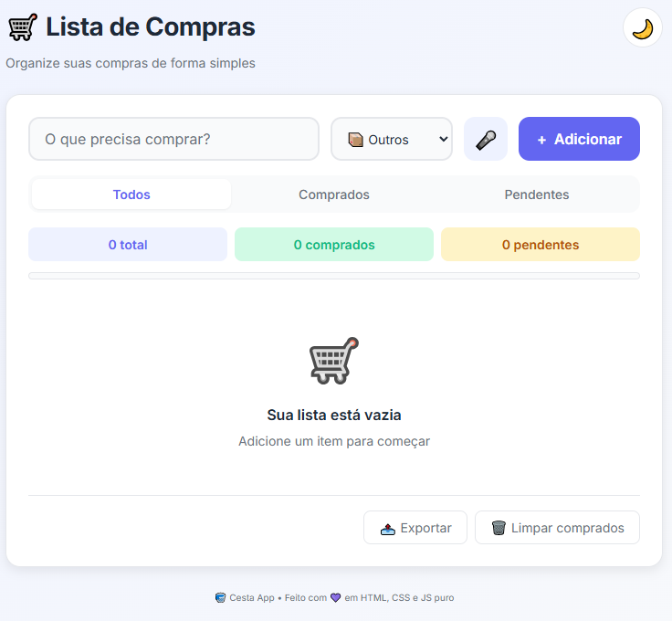
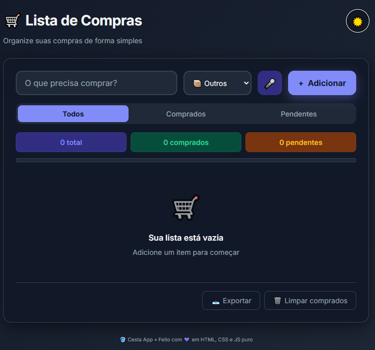

<p align="center">


<br>
<br>

**🧺 Lista de compras simples, bonita e inteligente.**

Um app web progressivo que transforma o ato de fazer compras em uma experiência agradável — com categorias, temas claro/escuro, reconhecimento de voz, exportação e microinterações encantadoras.

<br>

[](https://developer.mozilla.org/pt-BR/docs/Web/HTML)
[](https://developer.mozilla.org/pt-BR/docs/Web/CSS)
[](https://developer.mozilla.org/pt-BR/docs/Web/JavaScript)
[](LICENSE)
[](https://tercio1000.github.io/cestaapp/)

<br>

[🌐 Ver app online](https://tercio1000.github.io/cestaapp/) · [✨ Funcionalidades](#-funcionalidades) · [📸 Screenshots](#-screenshots) · [🚀 Como usar](#-como-usar) · [💜 Apoiar](#-apoie-o-projeto)

</p>

---

## 📖 Sobre o projeto

**Cesta App** é um aplicativo web de lista de compras construído com **HTML, CSS e JavaScript puro** — sem frameworks, sem dependências, sem build.

O objetivo é oferecer uma alternativa **bonita, rápida e privada** aos apps de lista de compras existentes. Todos os dados ficam salvos **localmente no navegador** do usuário (via `localStorage`), sem enviar nada para servidores.

> 💡 **Filosofia do projeto:** simplicidade radical. Um app que faz bem uma coisa só, com uma interface que dá prazer de usar.

---

## ✨ Funcionalidades

- 🛒 **Adicionar itens** com nome e categoria
- 🎨 **9 categorias com emojis** — frutas, verduras, carnes, laticínios, padaria, bebidas, limpeza, higiene e outros
- 🌙 **Tema claro e escuro** — respeita a preferência do sistema, com botão de alternância
- 🎤 **Reconhecimento de voz** — adicione itens ditando (Web Speech API)
- ✏️ **Edição inline** — clique e edite sem sair da lista
- 🔄 **Arrastar e soltar** — reordene os itens como quiser
- 🔍 **Filtros** — todos, comprados, pendentes
- 📊 **Barra de progresso** — acompanhe visualmente o avanço
- 📤 **Exportação** — baixe sua lista em `.txt`
- 🎉 **Confete** — comemore ao marcar itens como comprados
- 💾 **Persistência local** — os dados ficam no seu navegador
- 📱 **Design responsivo** — funciona em desktop, tablet e celular
- ♿ **Acessibilidade** — labels, aria-attributes e navegação por teclado

---

## 📸 Screenshots

<p align="center">

### ☀️ Tema claro



### 🌙 Tema escuro



</p>

---

## 🚀 Como usar

### 🅰️ Usar online (recomendado)

Acesse: **[https://tercio1000.github.io/cestaapp/](https://tercio1000.github.io/cestaapp/)**

Nada pra instalar. Nada pra baixar. Só abrir e usar. ✨

### 🅱️ Rodar localmente

```bash
# Clone o repositório
git clone https://github.com/tercio1000/cestaapp.git

# Entre na pasta
cd cestaapp

# Abra o arquivo index.html no navegador
# Ou use um servidor local:
python -m http.server 8000
# E acesse http://localhost:8000
🛠️ Stack de tecnologias
Camada	Tecnologia
Estrutura	HTML5 semântico
Estilo	CSS3 com custom properties (variáveis)
Lógica	JavaScript (ES6+) vanilla
Persistência	LocalStorage API
Voz	Web Speech API
Arrastar/soltar	HTML5 Drag and Drop API
Confete	Canvas API + requestAnimationFrame
Tipografia	Inter (Google Fonts)
Hospedagem	GitHub Pages
Fonte de dados	Nenhuma — 100% client-side
Zero dependências. Nenhum framework. Nenhuma biblioteca. Nenhum processo de build.

📂 Estrutura do projeto
text
cestaapp/
├── index.html              # Estrutura da aplicação
├── style.css               # Design system + estilos
├── script.js               # Lógica da aplicação
├── img/
│   ├── favicon.svg         # Ícone do app
│   ├── logo.svg            # Logo principal
│   └── logo-horizontal.svg # Logo com texto
├── screenshots/
│   ├── screenshot-light.png # Print do tema claro
│   └── screenshot-dark.png  # Print do tema escuro
├── LICENSE                 # Licença MIT
└── README.md               # Este arquivo
🎨 Design system
O projeto usa variáveis CSS para manter consistência visual e facilitar customização:

css
:root {
  --cor-primaria: #6366f1;   /* Índigo */
  --cor-sucesso:  #10b981;   /* Verde */
  --cor-perigo:   #ef4444;   /* Vermelho */
  --cor-aviso:    #f59e0b;   /* Âmbar */
  
  --esp-1: 4px;
  --esp-2: 8px;
  --esp-4: 16px;
  --esp-6: 24px;
  
  --raio-sm: 8px;
  --raio-md: 12px;
  --raio-lg: 16px;
}
Tema escuro é implementado via [data-theme="escuro"] — todas as variáveis são sobrescritas sem duplicar regras.

💜 Apoie o projeto
Cesta App é 100% gratuito e sempre será. Não tem anúncios, não vende dados, não tem versão "premium".

Se ele te ajuda no dia a dia e você quer contribuir para o desenvolvimento contínuo:

<p align="center">
https://img.shields.io/badge/Sponsor-%E2%9D%A4%EF%B8%8F-ea4aaa?style=for-the-badge&logo=github

</p>
Sua contribuição ajuda a manter:

🚀 Novas funcionalidades

🐛 Correção de bugs

📚 Documentação e tutoriais

☕ Café para o desenvolvedor (crucial!)

Outras formas de apoiar (gratuitas!):

⭐ Dar uma estrela no repositório

🐛 Reportar bugs via Issues

💡 Sugerir funcionalidades

📢 Compartilhar com amigos

🤝 Contribuindo
Contribuições são muito bem-vindas! Sinta-se à vontade para:

Fazer um fork do projeto

Criar uma branch para sua feature (git checkout -b feature/MinhaFeature)

Fazer commit das mudanças (git commit -m 'Adiciona MinhaFeature')

Fazer push pra branch (git push origin feature/MinhaFeature)

Abrir um Pull Request

Ideias de contribuição:

Novas categorias com emoji

Suporte a múltiplas listas

Compartilhamento via link

Sincronização na nuvem (opcional)

Suporte a PWA / instalação

Tradução para outros idiomas

📄 Licença
Este projeto está sob a Licença MIT — veja o arquivo LICENSE para detalhes.

Você pode usar, copiar, modificar, mesclar, publicar, distribuir, sublicenciar e/ou vender cópias do software, desde que mantenha o aviso de copyright original.

## 👤 Autor

<p align="center">
  <strong>Tercio M Sanches</strong><br>
  📍 Campinas/SP — Brasil
</p>

<p align="center">
  <a href="https://github.com/tercio1000">
    
  </a>
  <a href="mailto:sanchestm@gmail.com">
    
  </a>
</p>

<p align="center">
  <em>Desenvolvedor front-end apaixonado por criar produtos simples, bonitos e funcionais.</em>
</p>

---

<p align="center">
  <strong>🧺 Cesta App</strong> — Feito com 💜 em HTML, CSS e JS puro.
</p>

<p align="center">
  Se esse projeto te ajudou de alguma forma, considere dar uma ⭐!
</p>


